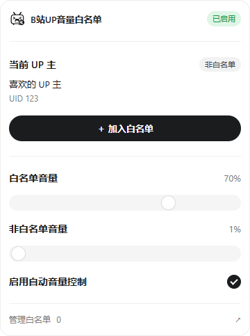

<p align="center">
  
</p>

# B站UP音量白名单

白名单内的 UP 主正常播放，其他 UP 主自动降低音量。支持桌面版 Chrome 和 Microsoft Edge。

## 功能

- 在视频弹窗中一键添加或移除当前 UP 主，独立管理页支持手动添加、备注、搜索和移除，紧凑列表每页显示 50 位。
- 管理页可导出 JSON 白名单备份；选择文件后可合并或替换导入（最多 10000 条、5 MB）。合并按 UID 去重并保留已有备注；替换只更换白名单，不改变音量和开关设置，空名单会清空原名单。
- 分别设置白名单与非白名单音量，默认 **70% / 1%**，设为 **0%** 即无声。
- 按 UID 匹配，切换视频后重新识别；等待或识别失败时保持低音量。
- 白名单和设置保存在本机，不需要账号，不会主动取消播放器静音。



[查看白名单管理页](docs/management-preview.png)

## 安装

### 使用发布包

从 [Releases](https://github.com/shadowdreamer/bilibili-voice-breaker/releases/latest) 下载扩展 ZIP（文件名包含 `chrome`，Chrome 和 Edge 共用），**先解压**到一个固定文件夹。请勿使用 GitHub 自动生成的 Source code ZIP 作为扩展安装包。

1. Chrome 打开 `chrome://extensions`，Edge 打开 `edge://extensions`。
2. 开启「开发者模式」，点击「加载已解压的扩展程序」。
3. 选择解压后**直接包含 `manifest.json`** 的文件夹。
4. 刷新 B 站视频页，点击扩展图标开始设置。完整名单通过「管理白名单」打开。

请保留安装文件夹。更新时替换该文件夹中的文件，再在扩展管理页点击「重新加载」，并刷新视频页。此方式不自动更新；目前未提供商店安装链接。

### 从源码构建

需要 Node.js 22+ 和 npm。在项目目录执行：

```sh
npm ci
npm run build
```

然后按上面的步骤加载 `.output/chrome-mv3`。

## 开发与打包

采用 WXT、TypeScript 和 Manifest V3，界面使用原生 HTML/CSS。

```sh
npm run dev        # 开发模式
npm run check      # 类型检查、策略测试、生产构建
npm run zip        # 生成发布用扩展 ZIP
```

发布包位于 `.output/bilibili-voice-breaker-<版本>-chrome.zip`，仅包含扩展运行文件。源码、测试、截图、图标原稿和依赖目录不会进入安装包。

GitHub Actions 会在提交和 PR 时执行类型检查、策略测试、生产构建与浏览器集成测试。发布新版本时，先同步修改 `package.json` 与 `package-lock.json` 的版本并提交，再推送对应的 `v<版本>` 标签；Release 工作流会重新验证、打包、生成 SHA-256 校验文件并发布。标签必须与包版本一致。可在 `docs/releases/v<版本>.md` 提供发布说明，未提供时自动生成。

开源仓库发布源码，并将上述 ZIP 作为 Release 附件即可；无需额外生成 `.crx`。若要让用户从商店直接安装并自动更新，需另行提交 Chrome Web Store / Edge Add-ons。两者接收 ZIP，`manifest.json` 必须在压缩包根目录。[Chrome 发布说明](https://developer.chrome.com/docs/webstore/prepare)、[Edge 发布说明](https://learn.microsoft.com/en-us/microsoft-edge/extensions/publish/publish-extension)。普通 Windows / macOS 用户不能仅凭自签名 CRX 获得 Chrome 的常规直接安装体验，参见 [Chrome 分发说明](https://developer.chrome.com/docs/extensions/how-to/distribute)。

### 浏览器测试

```sh
npm exec playwright install chromium
npm run build
npm run test:e2e
```

也可通过 `CHROMIUM_PATH` 指定支持扩展的 Chromium / Edge。Windows PowerShell 示例：

```powershell
$env:CHROMIUM_PATH = 'C:/Program Files (x86)/Microsoft/Edge/Application/msedge.exe'
npm run test:e2e
```

已在 Edge 139 上通过浏览器集成测试。测试使用隔离的浏览器资料、模拟视频页与接口响应，真实 B 站页面的验收项目见 [人工测试说明](docs/manual-testing.md)。Edge 与 Chrome 的扩展接口基本兼容，本项目共用一份 Manifest V3 构建，参见 [Edge 官方兼容说明](https://learn.microsoft.com/en-us/microsoft-edge/extensions/developer-guide/port-chrome-extension)。

图标原稿位于 `assets/logo-source.png`，安装 Pillow 后可执行 `python scripts/prepare-icons.py` 重新生成白底压缩图标。普通构建不需要 Python。

## 支持范围

仅支持 B 站 `/video/BV…`、`/video/av…` 普通视频页的标准 HTML5 播放器。直播、番剧、稍后再看、嵌入式播放器和特殊 HEVC 软解播放器暂不支持；特殊播放器会提示「未接管」。联合作品只识别主投稿者。

这是按 UP 主控制播放器音量的工具，不进行自动响度匹配或人声分离。启用期间，播放器音量会保持为扩展设定值；可暂停控制以恢复手动调节。B 站接口变更、风控或网络问题可能导致识别失败，无法保证所有场景下绝无瞬间漏音。

## 隐私与许可

设置仅保存在本机。为识别 UP 主，扩展会把当前视频的 BV / AV 号发送给 B 站接口，不携带账号凭据，无开发者后端或遥测。详见 [隐私说明](docs/privacy.md)。

本项目采用 [MIT License](LICENSE)。本项目为独立开发的第三方扩展，与哔哩哔哩无隶属关系。
